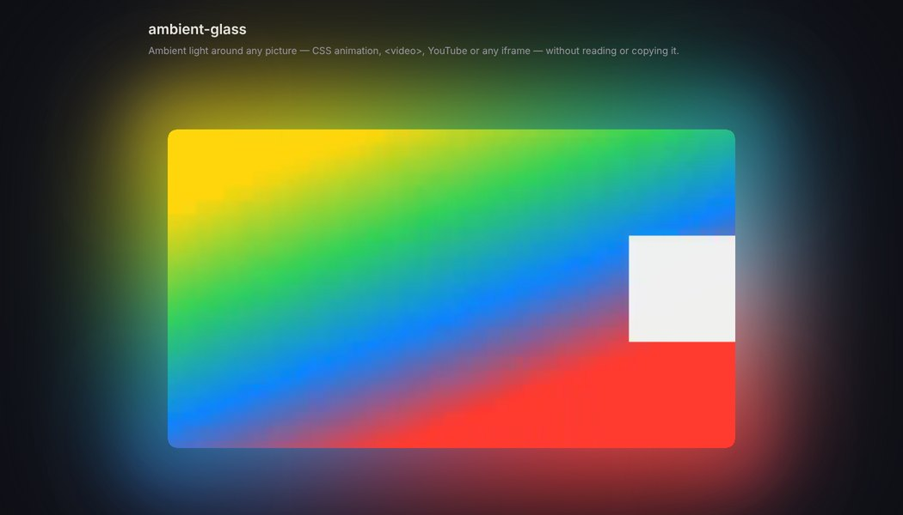
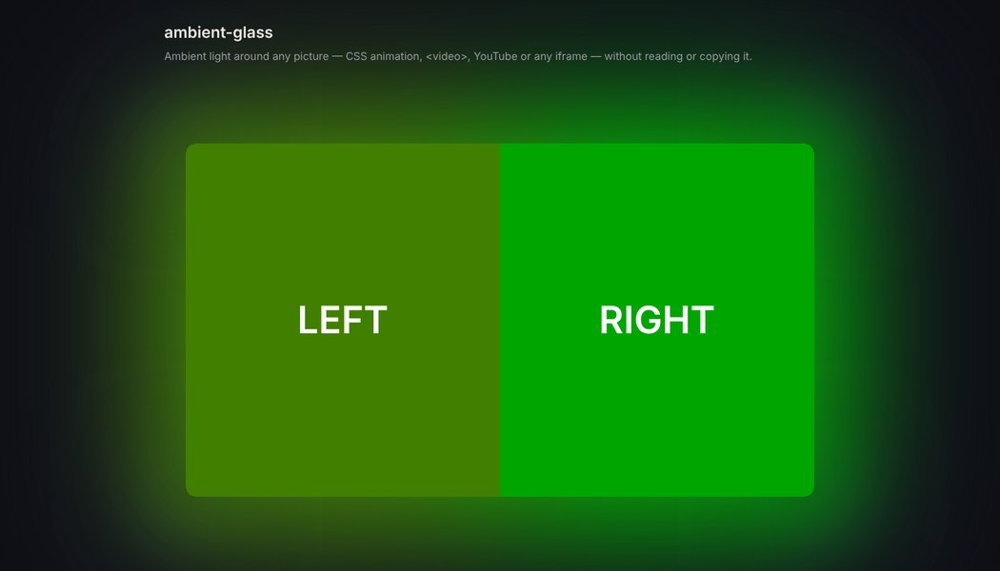
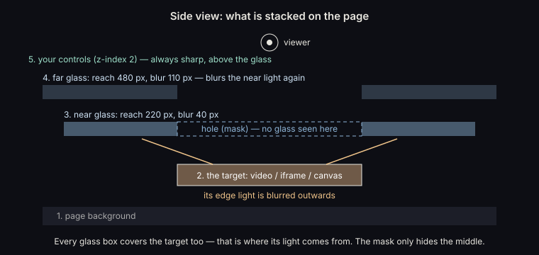
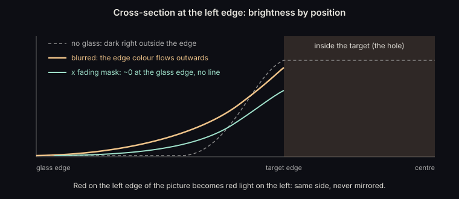
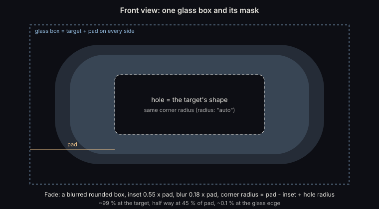
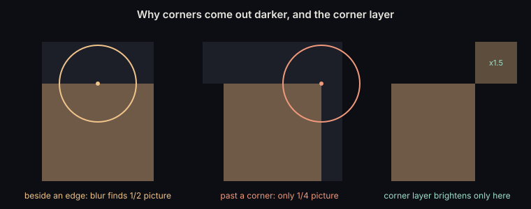
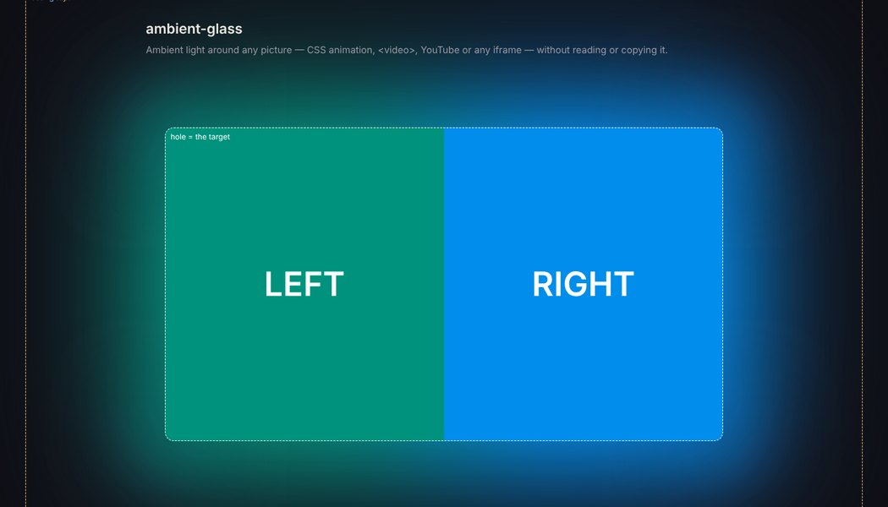

# ambient-glass

**An ambient glow around any video, iframe, canvas or element, without reading or copying it.**

ambient-glass gives you a soft light around a picture that changes colour with every frame, like YouTube's *Ambient mode*.

- It works with a `<video>`, a YouTube or other embedded player, a `<canvas>`, a CSS animation, or anything else on the page.
- There is no second video and no frame grabbing.
- No script runs per frame.
- It is one small file with no dependencies.

> 🇹🇭 ภาษาไทย: [README.th.md](README.th.md)

| `<video>` | Cross-origin `<iframe>` (the page cannot read it) |
|---|---|
|  |  |

---

## Why another way?

There are two common ways to make an ambient glow. Each has a limit.

| Approach | How | Limit |
|---|---|---|
| **Canvas** | A script draws every frame of the `<video>` onto a small `<canvas>`, which is blurred behind it | Only works for videos the page may read. **An embedded YouTube/Vimeo player is a cross-origin iframe, so the browser forbids reading it.** A script also has to run every frame. |
| **Duplicate** | Play the same video a second time, muted, scaled up and blurred behind | Two players, twice the network and decoding. Embedded players often may not be duplicated or overlaid. |
| **ambient-glass** | Lay a frosted glass (`backdrop-filter`) over the picture, with a hole cut where the picture is | Needs `backdrop-filter` (all current browsers). See [Rules](#rules-for-it-to-work). |

The browser is never asked to *give* us the pixels. It is asked to *draw* a blur of what is already on the screen, which it may always do. That is why this also works for cross-origin iframes.

---

## How it works

### 1. A frosted glass over the picture

`backdrop-filter: blur(...)` turns a box into frosted glass. Whatever is **under** the box is shown blurred. It is a see-through blur, not a mirror.

A glass box is placed over the target **and** a margin (`pad`) around it.



Blurring means averaging each point with its neighbours. A point on the glass just outside the target averages in the target's edge pixels, so the edge colour flows outwards. Further out, less of the picture is within reach, and the light fades away by itself.



This gives the glow three properties:

- **The colour stays on its own side.** Red on the left edge gives red light on the left.
- **It follows every frame.** The browser re-composites whenever what is under the glass changes. That happens on the GPU, with no JavaScript involved.
- **The light only reaches as far as the blur radius.** That is why there are two layers.

### 2. A mask cuts the hole and fades the edge

The glass covers the target too. Its light comes from there. A CSS `mask-image`, drawn as an SVG by the script, then decides what is visible:

- **The hole:** the target's exact shape, corner radius included, is hidden. The real picture shows through untouched, perfectly sharp.
- **The fade:** a blurred rounded box makes the glass fade to about 0 % exactly at its own edge. If the glass ended at even 5–8 %, a bright blur would show a hard straight line there.

Order matters: the browser blurs the **whole** box first and applies the mask afterwards. The hole does not weaken the glass. It only hides the middle of the result.



### 3. Two layers: near and far

| Layer | Reach (`pad`) | Default filter | Role |
|---|---|---|---|
| near | 220 px | `blur(40px) saturate(1.3) brightness(1.45)` | Light close to the picture. Little blur, so colours stay apart and the glow has depth. |
| far | 480 px | `blur(110px) brightness(1.25)` | Comes later in the page, so it **sees the near layer's light** and blurs it again. The glow spreads wide and soft. |

### 4. The corner layer

Just past a corner, the blur circle finds the picture in only a quarter of its area. Beside an edge it finds half. Corners therefore come out about half as bright.

The optional corner layer has no blur. It covers only the four quarter-planes beyond the corners, softened, and brightens the light the other layers already made.



Its filter `brightness(b) contrast(c)` uses `c = 0.45 / (0.5 − 0.05 × b)`. This lifts the light but keeps a near-black page (about 5 %) exactly as dark. With `brightness` alone, a lighter patch would show around each corner.

### 5. Kept in place

JavaScript only:

- positions the boxes, in whole pixels so the glass never overlaps the target's edge, and
- draws the masks.

It does this once, and again when the target or its container changes size (`ResizeObserver`) or the window resizes. Nothing runs while the video plays.

---

## Quick start

```html
<div class="player-wrap">
  <video id="player" src="movie.mp4" controls style="border-radius:12px"></video>
</div>

<script src="ambient-glass.js"></script>
<script>
  const glow = AmbientGlass.attach(document.getElementById("player"));
</script>
```

A YouTube embed is attached the same way:

```html
<div class="player-wrap">
  <iframe id="yt" src="https://www.youtube.com/embed/VIDEO_ID"
          referrerpolicy="strict-origin-when-cross-origin"
          allow="encrypted-media; picture-in-picture; fullscreen" allowfullscreen
          style="width:100%;aspect-ratio:16/9;border:0;border-radius:12px"></iframe>
</div>
<script>
  AmbientGlass.attach(document.getElementById("yt"));
</script>
```

The glass boxes are added to the target's parent, after the target, with `z-index: 1`. Put your own buttons and text that sit near the player at `z-index: 2` or higher, so they stay sharp.

### Options

```js
AmbientGlass.attach(target, {
  layers: [
    { pad: 220, filter: "blur(40px) saturate(1.3) brightness(1.45)" },
    { pad: 480, filter: "blur(110px) brightness(1.25)" }
  ],
  corners: { filter: "brightness(1.5) contrast(1.06)" },  // null = no corner layer
  small: {                       // replaces layers/corners on narrow screens; null = same everywhere
    maxWidth: 700,
    layers: [{ pad: 54, filter: "blur(16px) saturate(1.3) brightness(1.4)" }],
    corners: { filter: "brightness(1.4) contrast(1.05)" }
  },
  radius: "auto",                // hole corner radius in px, or "auto" = the target's border-radius
  fade: { inset: 0.55, soft: 0.18 },
  zIndex: 1,
  container: null                // default: the target's parent
});
```

### API

| Member | |
|---|---|
| `glow.update()` | Re-measure now. Rarely needed: size changes are watched. |
| `glow.enable(true/false)` | Show or hide the glow, for example from a toggle. |
| `glow.set(options)` | Change options live, as the demo's sliders do. |
| `glow.layers` | The glass elements, for debugging. |
| `glow.destroy()` | Remove everything. |

---

## Tuning

| You want | Change |
|---|---|
| Light reaching further or closer | `pad` |
| Softer light, or more colour separation and depth | `blur(...)`: less = colours stay apart, more = one even wash |
| Brighter or dimmer | `brightness(...)` |
| Richer or plainer colour | `saturate(...)`. Too high tints a dark-blue page purple. |
| Corners brighter or darker than the sides | the corner layer's `brightness(b)`, with `contrast = 0.45 / (0.5 − 0.05 b)` |

Open `demo/index.html` and move the sliders. The code for your settings is printed below them. **Show the glass boxes** draws where each layer and the hole are.



---

## Rules for it to work

1. **The glass must be painted after the target, in the same stacking context.** `attach` does this by appending to the target's parent. If you choose another `container`, keep the target inside it.
2. **Nothing between them may start a new "backdrop root".** That means no `filter`, `opacity < 1`, `mask`, `clip-path`, `backdrop-filter` or `mix-blend-mode` on an element that contains the glass but not the target. A glass inside such an element only sees what is inside it.
3. **Don't clip the container.** `overflow: hidden` on it, or on an ancestor near it, cuts the light off. The glass reaches past the page edges, so you may want `overflow-x: hidden` on `body` to avoid a horizontal scrollbar.
4. **Everything under the glass becomes light.** Text or images next to the player are blurred into the glow too. Keep your own content above the glass (`z-index ≥ 2`), or leave room around the player.
5. **Clicks pass through.** The glass has `pointer-events: none`, so the player stays fully usable.
6. **It is hidden in full screen** and for users who ask for less transparency (`prefers-reduced-transparency`).
7. **Cost:** blur is done on the GPU and scales with area × radius. The defaults use one lighter layer on narrow screens. Very large `pad` or `blur` values cost more.

### Embedded players (YouTube, Vimeo, …)

- **Nothing is placed over the player.** The player area is a hole in every layer.
- **Nothing is read, recorded, copied or modified.** There is only one player, and its ads and view counts work as usual.
- **Keep the referrer.** Use `referrerpolicy="strict-origin-when-cross-origin"` on the iframe. A page-wide `no-referrer` makes YouTube refuse to play (error 153).
- Each platform has its own embedding terms. Following them is your responsibility.

---

## Browser support

- **`backdrop-filter`:** supported by current Chrome, Edge, Safari and Firefox ([caniuse](https://caniuse.com/css-backdrop-filter)).
- **CSS masks:** both `mask-image` and `-webkit-mask-image` are set.

| Tested | Result |
|---|---|
| Chromium 153 (this repo's demo) | CSS animation, `<video>`, **cross-origin iframe** (the page script is blocked from reading it): the glow follows the colours on the correct side |
| Chrome with real YouTube embeds | Used live on [dooridee-anime.com](https://dooridee-anime.com/) |
| Safari, Firefox | **Not tested yet.** Reports and screenshots are welcome. |

---

## Demo

Browsers block some things on `file://`, so serve the folder:

```bash
python -m http.server 8000      # or: npx serve
# open http://localhost:8000/demo/
```

The demo has a CSS animation, a `<video>` (`sample.mp4`, generated colour gradients) or your own video file, an iframe, and YouTube (paste any link or id).

---

## youtube ambient-glass


## my ambient-glass


## Credits

Built for **ดูไรดีอนิเมะ** ([dooridee-anime.com](https://dooridee-anime.com/)), a guide to licensed anime in Thailand, by **KUJU** ([kuju29.com](https://kuju29.com/)).

## License

MIT. See [LICENSE](LICENSE).
