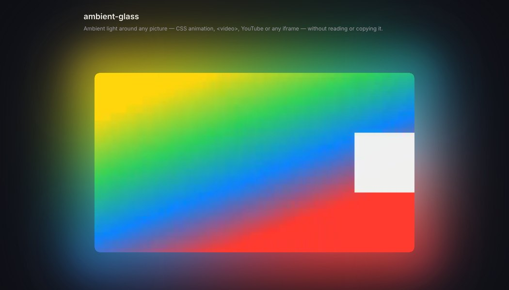
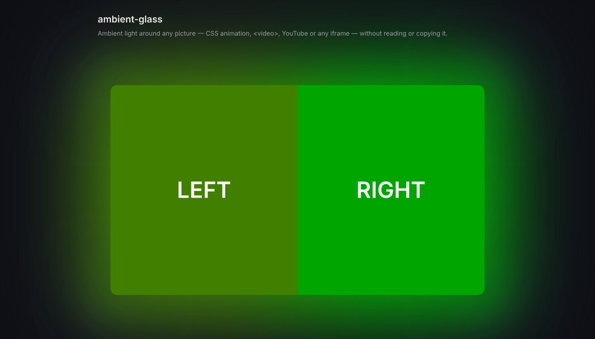
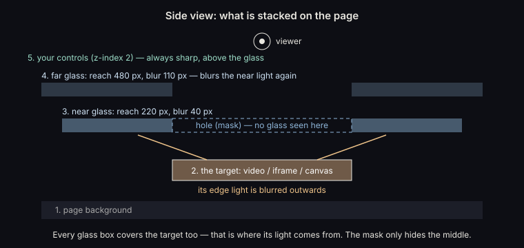
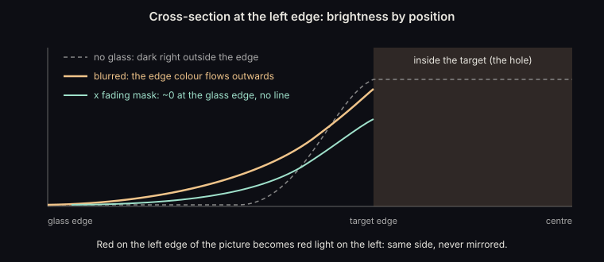
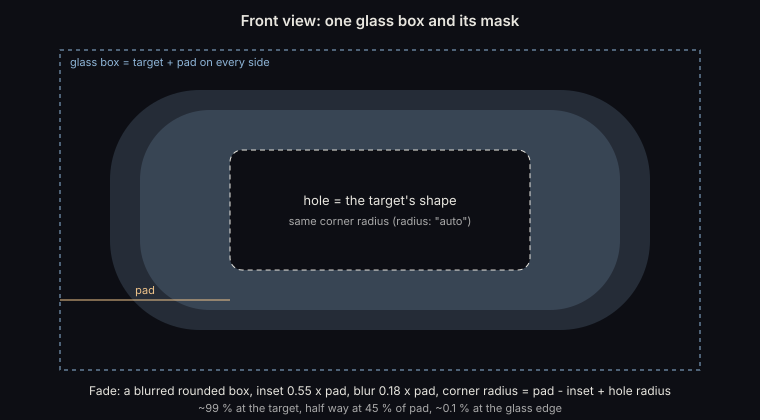
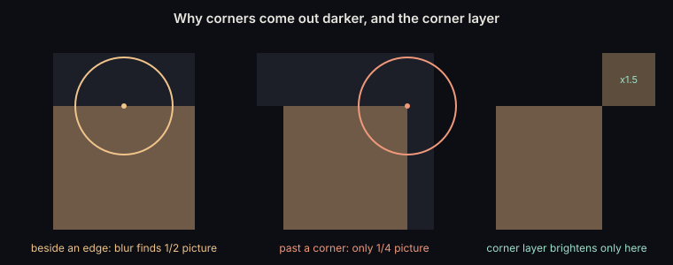
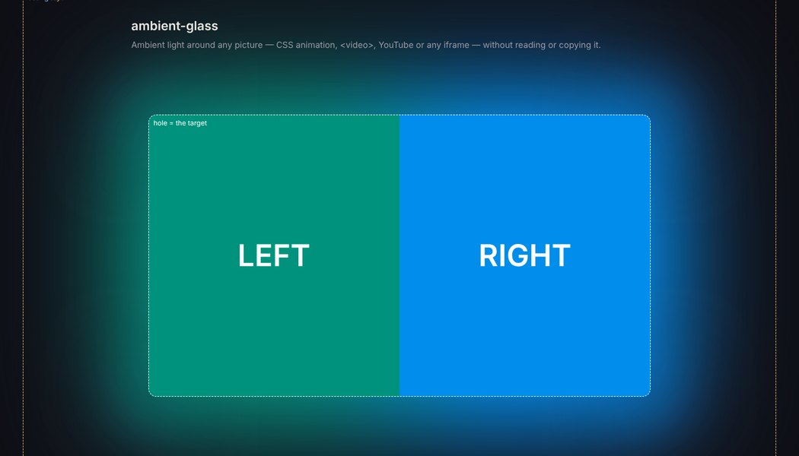

# ambient-glass

**แสงรอบจอ (ambient glow) สำหรับวีดีโอ iframe canvas หรือ element ใดก็ได้ โดยไม่อ่านและไม่ก๊อปภาพ**

ambient-glass ทำให้มีแสงนุ่มๆ ฟุ้งรอบภาพ และเปลี่ยนสีตามภาพทุกเฟรม คล้าย *Ambient mode* ของ YouTube

- ใช้ได้กับ `<video>`, เครื่องเล่น YouTube หรือเครื่องเล่นแบบฝังอื่นๆ, `<canvas>`, ภาพเคลื่อนไหว CSS และอะไรก็ได้บนหน้าเว็บ
- ไม่ต้องเล่นวีดีโอตัวที่สอง และไม่ต้องดึงเฟรมมาวาดเอง
- ไม่มีสคริปต์ทำงานทุกเฟรม
- เป็นไฟล์เล็กไฟล์เดียว ไม่ต้องลงไลบรารีอื่นเพิ่ม

> 🇬🇧 English: [README.md](README.md)

| `<video>` | `<iframe>` จากเว็บอื่น (หน้าเว็บอ่านไม่ได้) |
|---|---|
|  |  |

---

## ทำไมต้องมีวิธีใหม่

วิธีทำแสงรอบจอที่นิยมมีอยู่สองแบบ และทั้งสองแบบมีข้อจำกัด

| วิธี | ทำยังไง | ข้อจำกัด |
|---|---|---|
| **Canvas** | สคริปต์วาดทุกเฟรมของ `<video>` ลง `<canvas>` เล็กๆ แล้วเบลอวางไว้ข้างหลัง | ใช้ได้เฉพาะวีดีโอที่หน้าเว็บมีสิทธิ์อ่าน **YouTube หรือ Vimeo ที่ฝังมาเป็น iframe จากเว็บอื่น เบราว์เซอร์จึงห้ามอ่าน** และต้องมีสคริปต์ทำงานทุกเฟรม |
| **ทำสำเนา** | เล่นวีดีโอเดียวกันซ้ำอีกตัว ปิดเสียง ขยาย แล้วเบลอไว้ข้างหลัง | มีเครื่องเล่น 2 ตัว กินเน็ตและเครื่องเป็นสองเท่า และเครื่องเล่นแบบฝังส่วนใหญ่ไม่ควรถูกทำซ้ำหรือถูกวางของทับ |
| **ambient-glass** | วางกระจกฝ้า (`backdrop-filter`) ทับภาพ แล้วเจาะรูตรงที่เป็นภาพ | ต้องใช้เบราว์เซอร์ที่มี `backdrop-filter` ซึ่งเบราว์เซอร์ปัจจุบันมีทั้งหมด ดู[เงื่อนไขที่ต้องมี](#เงื่อนไขที่ต้องมี) |

เราไม่ได้ขอให้เบราว์เซอร์**ส่งพิกเซลมาให้** เราขอแค่ให้มัน**วาดภาพเบลอ**ของสิ่งที่แสดงอยู่บนจออยู่แล้ว ซึ่งเบราว์เซอร์ทำให้ได้เสมอ วิธีนี้จึงใช้ได้กับ iframe จากเว็บอื่นด้วย

---

## หลักการทำงาน

### 1. กระจกฝ้าวางทับภาพ

`backdrop-filter: blur(...)` ทำให้กล่องหนึ่งกลายเป็นกระจกฝ้า สิ่งที่อยู่**ใต้**กล่องจะถูกแสดงแบบเบลอ เป็นการมองทะลุลงไป ไม่ใช่กระจกเงาที่สะท้อนภาพ

เราวางกล่องกระจกให้ครอบทั้งตัวภาพ**และ**ขอบรอบๆ ภาพออกไปอีกระยะหนึ่ง (`pad`)



การเบลอคือการเอาสีของแต่ละจุดไปเฉลี่ยกับจุดรอบๆ จุดบนกระจกที่อยู่นอกภาพใกล้ๆ ขอบจะดึงสีจากขอบภาพมาปน สีจึงไหลออกไปด้านนอก ยิ่งไกลออกไป ภาพที่อยู่ในรัศมีเบลอก็ยิ่งน้อย แสงจึงจางหายไปเอง



แสงที่ได้จึงมีคุณสมบัติสามข้อ:

- **สีอยู่ฝั่งเดียวกับภาพ** ขอบซ้ายของภาพเป็นสีแดง แสงด้านซ้ายก็เป็นสีแดง
- **เปลี่ยนตามทุกเฟรม** เบราว์เซอร์จะวาดใหม่ทุกครั้งที่สิ่งที่อยู่ใต้กระจกเปลี่ยน และทำบนการ์ดจอ ไม่ต้องใช้ JavaScript
- **แสงไปได้ไกลแค่รัศมีเบลอ** จึงต้องมีกระจกสองชั้น

### 2. มาสก์: เจาะรูและทำให้ขอบจาง

กระจกครอบทับตัวภาพด้วย เพราะแสงมาจากตรงนั้น จากนั้นใช้ `mask-image` ที่สคริปต์วาดเป็น SVG กำหนดว่าส่วนไหนจะมองเห็น:

- **รู:** ซ่อนส่วนที่เป็นรูปทรงของภาพพอดี รวมถึงมุมโค้ง ตรงนั้นจึงเห็นภาพตัวจริงคมชัด ไม่ถูกแตะต้อง
- **ความจาง:** กล่องมุมมนที่เบลอขอบ ทำให้กระจกจางเหลือประมาณ 0% พอดีที่ขอบของตัวเอง ถ้าปลายกระจกยังเหลือแค่ 5–8% แสงที่เบลอและสว่างจะกลายเป็นเส้นตรงให้เห็น

ลำดับการทำงานสำคัญ: เบราว์เซอร์เบลอ**ทั้งกล่อง**ก่อน แล้วค่อยใช้มาสก์ทีหลัง การเจาะรูจึงไม่ทำให้กระจกอ่อนลง แค่ซ่อนผลลัพธ์ตรงกลางไว้



### 3. กระจกสองชั้น: ใกล้และไกล

| ชั้น | ระยะ (`pad`) | ฟิลเตอร์เริ่มต้น | หน้าที่ |
|---|---|---|---|
| ใกล้ | 220px | `blur(40px) saturate(1.3) brightness(1.45)` | แสงติดภาพ เบลอน้อย สีแต่ละส่วนยังแยกกัน แสงจึงดูมีมิติ |
| ไกล | 480px | `blur(110px) brightness(1.25)` | อยู่ทีหลังในหน้าเว็บ จึง**เห็นแสงของชั้นใกล้**แล้วเอาไปเบลอซ้ำ แสงจึงฟุ้งไปไกลและนุ่ม |

### 4. ชั้นมุม

ตรงที่เลยมุมออกไป วงกลมของการเบลอเจอภาพแค่หนึ่งในสี่ ในขณะที่ข้างขอบเจอครึ่งหนึ่ง มุมจึงมืดกว่าด้านข้างประมาณครึ่งหนึ่ง

ชั้นมุมเป็นตัวเลือกเสริม มันไม่เบลอ แต่ครอบเฉพาะพื้นที่ที่เลยมุมออกไปทั้งสี่มุม ขอบนุ่ม แล้วเพิ่มความสว่างให้แสงที่ชั้นอื่นสร้างไว้แล้ว



ฟิลเตอร์ `brightness(b) contrast(c)` ใช้สูตร `c = 0.45 / (0.5 − 0.05 × b)` เพื่อให้แสงสว่างขึ้น แต่พื้นหลังที่เกือบดำ (ประมาณ 5%) ยังมืดเท่าเดิม ถ้าใช้ `brightness` อย่างเดียว จะเห็นเป็นแผ่นสว่างรอบมุม

### 5. ตามขนาดภาพเสมอ

JavaScript ทำแค่สองอย่าง:

- จัดตำแหน่งกล่องกระจก ใช้พิกเซลเต็มเพื่อไม่ให้กระจกทับขอบภาพ
- วาดมาสก์

ทำครั้งแรกครั้งเดียว แล้วทำใหม่เมื่อภาพหรือกล่องที่ครอบเปลี่ยนขนาด (`ResizeObserver`) หรือเมื่อย่อขยายหน้าต่าง ระหว่างวีดีโอเล่นไม่มีสคริปต์ทำงานเลย

---

## เริ่มใช้งาน

```html
<div class="player-wrap">
  <video id="player" src="movie.mp4" controls style="border-radius:12px"></video>
</div>

<script src="ambient-glass.js"></script>
<script>
  const glow = AmbientGlass.attach(document.getElementById("player"));
</script>
```

YouTube แบบฝังก็ใช้แบบเดียวกัน:

```html
<div class="player-wrap">
  <iframe id="yt" src="https://www.youtube.com/embed/VIDEO_ID"
          referrerpolicy="strict-origin-when-cross-origin"
          allow="encrypted-media; picture-in-picture; fullscreen" allowfullscreen
          style="width:100%;aspect-ratio:16/9;border:0;border-radius:12px"></iframe>
</div>
<script>
  AmbientGlass.attach(document.getElementById("yt"));
</script>
```

กระจกจะถูกใส่ไว้ใน element แม่ของภาพ ต่อท้ายตัวภาพ และมี `z-index: 1` ปุ่มหรือข้อความของคุณที่อยู่ใกล้เครื่องเล่น ให้ตั้ง `z-index: 2` ขึ้นไป จะได้คมชัดไม่โดนกระจกทับ

### ตัวเลือก

```js
AmbientGlass.attach(target, {
  layers: [
    { pad: 220, filter: "blur(40px) saturate(1.3) brightness(1.45)" },
    { pad: 480, filter: "blur(110px) brightness(1.25)" }
  ],
  corners: { filter: "brightness(1.5) contrast(1.06)" },  // null = ไม่ใช้ชั้นมุม
  small: {                       // ใช้แทน layers/corners บนจอแคบ; null = ใช้ค่าเดียวกันทุกขนาด
    maxWidth: 700,
    layers: [{ pad: 54, filter: "blur(16px) saturate(1.3) brightness(1.4)" }],
    corners: { filter: "brightness(1.4) contrast(1.05)" }
  },
  radius: "auto",                // รัศมีมุมของรู หน่วย px หรือ "auto" = ใช้ border-radius ของภาพ
  fade: { inset: 0.55, soft: 0.18 },
  zIndex: 1,
  container: null                // ค่าเริ่มต้น: element แม่ของภาพ
});
```

### คำสั่ง (API)

| คำสั่ง | |
|---|---|
| `glow.update()` | วัดขนาดใหม่ทันที แทบไม่ต้องใช้ เพราะระบบคอยดูการเปลี่ยนขนาดอยู่แล้ว |
| `glow.enable(true/false)` | เปิดหรือปิดแสง เช่น ผูกกับปุ่มเปิดปิด |
| `glow.set(options)` | เปลี่ยนค่าได้ทันที แบบที่แถบเลื่อนในเดโมทำ |
| `glow.layers` | element ของกระจกแต่ละชั้น ไว้ใช้ตอนดีบัก |
| `glow.destroy()` | ลบทุกอย่างออก |

---

## การปรับแต่ง

| อยากได้ | ปรับ |
|---|---|
| แสงไปไกลขึ้นหรือใกล้ลง | `pad` |
| แสงนุ่มขึ้น หรือสีแยกส่วนมีมิติขึ้น | `blur(...)` ค่าน้อย = สีแยกกันชัด ค่ามาก = ฟุ้งเป็นสีเดียว |
| สว่างขึ้นหรือหรี่ลง | `brightness(...)` |
| สีอิ่มขึ้นหรือจืดลง | `saturate(...)` ถ้าสูงเกินไป พื้นสีกรมท่าจะออกม่วง |
| มุมสว่างกว่าหรือมืดกว่าด้านข้าง | `brightness(b)` ของชั้นมุม พร้อมใช้ `contrast = 0.45 / (0.5 − 0.05 b)` |

เปิด `demo/index.html` แล้วลองเลื่อนแถบ โค้ดของค่าที่ตั้งไว้จะแสดงอยู่ด้านล่าง ติ๊ก **Show the glass boxes** เพื่อดูว่ากระจกแต่ละชั้นและรูอยู่ตรงไหน



---

## เงื่อนไขที่ต้องมี

1. **กระจกต้องถูกวาดหลังภาพ และอยู่ใน stacking context เดียวกัน** `attach` จัดการให้แล้วโดยใส่กระจกไว้ใน element แม่ของภาพ ถ้ากำหนด `container` เอง ต้องให้ภาพอยู่ข้างในด้วย
2. **ห้ามมีอะไรคั่นกลางที่สร้าง "backdrop root" ใหม่** ได้แก่ `filter`, `opacity < 1`, `mask`, `clip-path`, `backdrop-filter` หรือ `mix-blend-mode` บน element ที่ครอบกระจกแต่ไม่ได้ครอบภาพ ถ้ากระจกอยู่ใน element แบบนั้น มันจะเห็นแค่สิ่งที่อยู่ข้างใน element นั้น
3. **ห้ามตัดขอบกล่องที่ครอบ** ถ้ากล่องนั้นหรือ element ใกล้ๆ ที่ครอบอยู่ตั้ง `overflow: hidden` แสงจะถูกตัด และเพราะกระจกยื่นเลยขอบหน้าเว็บ อาจต้องตั้ง `overflow-x: hidden` ที่ `body` เพื่อไม่ให้มีแถบเลื่อนแนวนอน
4. **ทุกอย่างที่อยู่ใต้กระจกจะกลายเป็นแสง** ตัวหนังสือหรือรูปที่อยู่ข้างเครื่องเล่นจะถูกเบลอปนเข้าไปในแสงด้วย ให้ตั้งเนื้อหาของคุณไว้เหนือกระจก (`z-index ≥ 2`) หรือเว้นที่ว่างรอบเครื่องเล่น
5. **คลิกทะลุได้** กระจกตั้ง `pointer-events: none` ไว้ เครื่องเล่นจึงใช้งานได้ปกติ
6. **ซ่อนอัตโนมัติ** ตอนดูเต็มจอ และเมื่อผู้ใช้ตั้งเครื่องไว้ว่าต้องการความโปร่งใสน้อย (`prefers-reduced-transparency`)
7. **ภาระเครื่อง:** การเบลอทำบนการ์ดจอ ยิ่งพื้นที่ใหญ่และรัศมีเบลอมาก ยิ่งใช้แรงมาก ค่าเริ่มต้นบนจอแคบจึงใช้ชั้นเดียวที่เบากว่า ถ้าตั้ง `pad` หรือ `blur` สูงมากจะกินเครื่องมากขึ้น

### เครื่องเล่นแบบฝัง (YouTube, Vimeo …)

- **ไม่มีอะไรวางทับเครื่องเล่น** ตรงเครื่องเล่นเป็นรูในกระจกทุกชั้น
- **ไม่อ่าน ไม่บันทึก ไม่ก๊อป และไม่ดัดแปลงอะไร** มีเครื่องเล่นตัวเดียว โฆษณาและยอดวิวทำงานตามปกติ
- **ต้องส่ง referrer** ให้ใส่ `referrerpolicy="strict-origin-when-cross-origin"` ที่ iframe ถ้าทั้งหน้าตั้ง `no-referrer` ไว้ YouTube จะไม่ยอมเล่น (error 153)
- แต่ละแพลตฟอร์มมีข้อกำหนดการฝังของตัวเอง ผู้ใช้ต้องปฏิบัติตามเอง

---

## เบราว์เซอร์ที่รองรับ

- **`backdrop-filter`:** มีใน Chrome, Edge, Safari และ Firefox รุ่นปัจจุบัน ([caniuse](https://caniuse.com/css-backdrop-filter))
- **มาสก์ CSS:** ตั้งทั้ง `mask-image` และ `-webkit-mask-image` ไว้ให้แล้ว

| ทดสอบแล้ว | ผล |
|---|---|
| Chromium 153 (เดโมใน repo นี้) | ภาพเคลื่อนไหว CSS, `<video>` และ **iframe จากเว็บอื่น** (สคริปต์ของหน้าถูกห้ามอ่าน): แสงเปลี่ยนสีตามภาพ และสีอยู่ถูกฝั่ง |
| Chrome กับ YouTube แบบฝังจริง | ใช้งานจริงอยู่บน [dooridee-anime.com](https://dooridee-anime.com/) |
| Safari, Firefox | **ยังไม่ได้ทดสอบ** ใครลองแล้วช่วยแจ้งผลพร้อมภาพหน้าจอได้เลย |

---

## เดโม

เบราว์เซอร์บล็อกบางอย่างเมื่อเปิดไฟล์ตรงๆ แบบ `file://` จึงต้องเปิดผ่านเซิร์ฟเวอร์:

```bash
python -m http.server 8000      # หรือ: npx serve
# เปิด http://localhost:8000/demo/
```

ในเดโมมี: ภาพเคลื่อนไหว CSS, `<video>` (`sample.mp4` เป็นสีไล่ระดับที่สร้างขึ้นเอง) หรือเลือกไฟล์วีดีโอของคุณเอง, iframe และ YouTube (วางลิงก์หรือรหัสคลิปได้เลย)

---

## ที่มา

สร้างขึ้นสำหรับ **ดูไรดีอนิเมะ** ([dooridee-anime.com](https://dooridee-anime.com/)) เว็บรวมอนิเมะถูกลิขสิทธิ์ในไทย โดย **KUJU** ([kuju29.com](https://kuju29.com/))

## สัญญาอนุญาต

MIT ดูไฟล์ [LICENSE](LICENSE)
